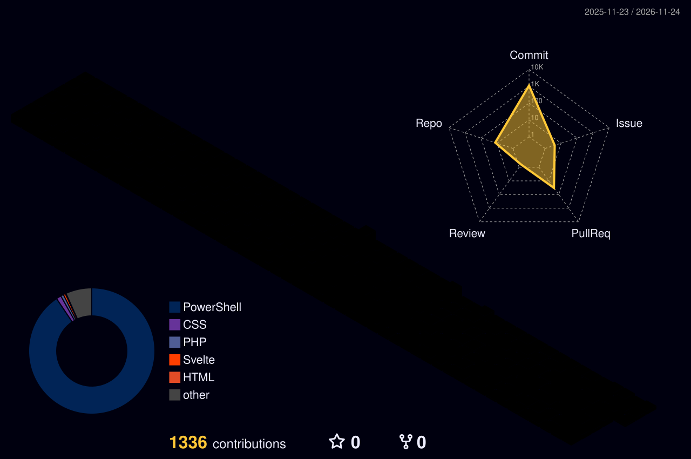

  <!-- Typing SVG Dynamic Header -->
  

  

    <b>Passionate Software Engineer & Systems Builder</b> based in Indonesia 🇮🇩 
    Specializing in resilient web applications, intelligent automation, and human-grade digital solutions.
  

  

    
    
    
    
  

  ---

  ### 🧊 3D Isometric Contribution Graph

  <!-- GitHub 3D Contribution Graph Render (Dark/Light responsive) -->
  <picture>
    <source media="(prefers-color-scheme: dark)" srcset="./profile-3d-contrib/profile-night-rainbow.svg">
    <source media="(prefers-color-scheme: light)" srcset="./profile-3d-contrib/profile-season-animate.svg">
    
  </picture>

  ---

  ### 🚀 Featured Engineering & Open Source

  <table width="100%">
    <tr>
      <td width="50%" valign="top">
        <h4>🤖 <a href="https://github.com/cloudy0903/AI-Cli">AI-Cli</a></h4>
        
Sistem agen kecerdasan buatan berbasis CLI untuk mengotomatisasi seluruh siklus hidup pengembangan perangkat lunak (SDLC) dari konsep hingga <i>ready-to-deploy</i>.

        
<code>Python</code> • <code>AI Agents</code> • <code>Automation</code>

      </td>
      <td width="50%" valign="top">
        <h4>💳 <a href="https://github.com/cloudy0903/Sistem-POS">Sistem POS</a></h4>
        
Sistem informasi Point of Sale (POS) modern dan skalabel yang dirancang untuk mendukung operasional multi-sektor usaha secara efisien.

        
<code>Web App</code> • <code>Database</code> • <code>Enterprise</code>

      </td>
    </tr>
    <tr>
      <td width="50%" valign="top">
        <h4>⚡ <a href="https://github.com/cloudy0903/QR_Genegator">QR Generator</a></h4>
        
Aplikasi web interaktif berkinerja tinggi untuk pembuatan kode QR kustom secara instan dan responsif.

        
<code>Svelte</code> • <code>TypeScript</code> • <code>Reactive UI</code>

      </td>
      <td width="50%" valign="top">
        <h4>💈 <a href="https://github.com/cloudy0903/BarberShop">BarberShop Platform</a></h4>
        
Antarmuka web modern dengan kecepatan loading maksimal menggunakan arsitektur content-driven islands.

        
<code>Astro</code> • <code>Tailwind CSS</code> • <code>UI/UX</code>

      </td>
    </tr>
  </table>

  ---

  ### 🛠️ Tech Stack & Ecosystem

  
<b>Languages & Core:</b>

  

    
  

  
<b>Frontend & UI Frameworks:</b>

  

    
  

  
<b>Backend & Databases:</b>

  

    
  

  
<b>DevOps & Environment:</b>

  

    
  

  ---

  ### 📊 GitHub Activity Telemetry

  

    
    &nbsp;
    
  

   
  Designed with precision • <b>Sugiyanto Prasetio</b> (@cloudy0903)

